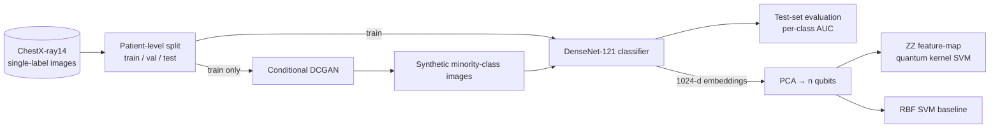

# Respiratory Disease Classification from Chest X-Rays


Multiclass classification of respiratory findings on the NIH ChestX-ray14 dataset. It uses DenseNet-121 transfer learning, a class-conditional GAN that synthesises extra training images for under-represented diseases, and a quantum-kernel SVM (QSVM) evaluated against a classical SVM on the learned embeddings.

> **Publication.** Published in the *Journal of the Biomedical Engineering Society of India*, Vol. 18 (2023). Best Poster Award, NSRTBME 2023.

## Results

| Model | Test AUC (macro, one-vs-rest) |
|---|---|
| DenseNet-121, real images only | 0.78 |
| DenseNet-121 + GAN-augmented minority classes | **0.82** |

These are the figures reported in the paper. Running `evaluate` writes your own numbers to `outputs/metrics_*.json`, and `qsvm` writes the quantum-vs-classical SVM comparison to `outputs/qsvm_*.json`.

## Method



1. **Data.** Single-label images from the configured findings (default: No Finding, Atelectasis, Effusion, Infiltration, Pneumonia, Pneumothorax). Splits are patient-disjoint, using the official `test_list.txt`, so no patient leaks between train and test. Majority classes are undersampled and the loss uses inverse-frequency class weights.
2. **GAN augmentation.** A class-conditional DCGAN (128×128, label-embedding conditioning, one-sided label smoothing) is trained only on training-split images. Its samples are added only to the training set and never to validation or test.
3. **Classifier.** DenseNet-121 pretrained on ImageNet. It trains in two phases: the head on frozen features, then end-to-end fine-tuning at a lower learning rate, with the checkpoint chosen by validation AUC.
4. **QSVM.** Pooled DenseNet features are reduced with PCA to *n* dimensions and mapped to rotation angles. A ZZ feature map gives a fidelity quantum kernel (Qiskit), which feeds an SVM. An RBF SVM on the same features is the classical baseline. Kernel evaluation scales as O(n²) circuits, so this stage runs on a stratified subsample.

## Usage

```bash
pip install -r requirements.txt
```

Download ChestX-ray14 from the [NIH Clinical Center](https://nihcc.app.box.com/v/ChestXray-NIHCC) into `data/nih-chestxray14/`. That folder should contain `Data_Entry_2017.csv`, `test_list.txt` and the `images_*/` folders. Then run:

```bash
python -m cxr train                  # baseline classifier (real images only)
python -m cxr evaluate

python -m cxr gan                    # train the GAN, write synthetic images
python -m cxr train --synthetic      # classifier with GAN augmentation
python -m cxr evaluate --synthetic

python -m cxr qsvm --synthetic       # quantum vs. classical SVM on embeddings
```

All hyperparameters (classes, image sizes, epochs, synthetic counts per class, qubits) live in [`configs/default.yaml`](configs/default.yaml).

## Tests

`pytest -q tests` runs every stage end to end on a tiny generated dataset that mimics the ChestX-ray14 layout. It checks the patient-disjoint splits, metadata filtering and metric edge cases in under a minute on CPU. CI runs it on every push.

## Layout

```
cxr/data.py       metadata filtering, patient-level splits, tf.data pipelines
cxr/gan.py        conditional DCGAN
cxr/models.py     DenseNet-121 classifier + embedding extractor
cxr/metrics.py    per-class / macro AUC, accuracy, F1, confusion matrix
cxr/pipeline.py   gan · train · evaluate · qsvm stages
configs/          experiment configuration
```
